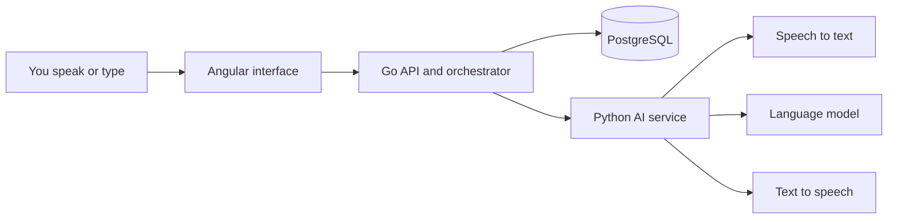
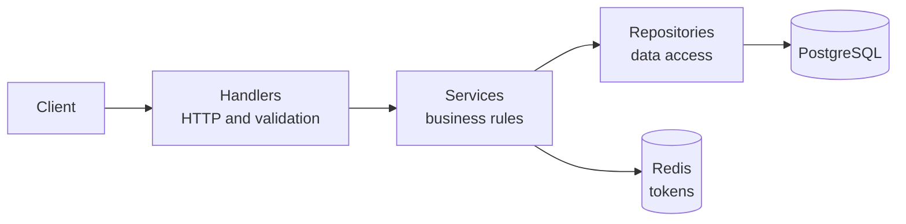

# Hi, I'm Nilabh Subramaniam

**Frontend-focused full-stack developer in Gurugram, India**

I've worked as a developer since 2015, mostly with Angular and TypeScript, on insurance, wealth management, advertising and service-level platforms. I now build backends in Go and local AI services in Python as well.

My own projects start close to home: software that understands Indian languages, and places to discover Indian crafts. I speak English, Hindi and Maithili.

[Portfolio](https://sankalan.fly.dev) · [LinkedIn](https://www.linkedin.com/in/nilabh-subramaniam-0912a7a0/)

 

---

## Featured projects

### VaaniSetu: a voice bridge for Indian languages

[Code](https://github.com/nilabhsubramaniam/VaaniSetu)

Voice assistants are usually cloud services, and many struggle when a sentence mixes Hindi and English. VaaniSetu runs open-source models on your own machine: you speak or type, it transcribes, replies and speaks back.

- **Ten language options:** Hindi, Hinglish, Bengali, Gujarati, Marathi, Tamil, Telugu, Kannada, Malayalam and Punjabi
- **Chosen by measurement:** models are benchmarked for each language. Odia and Maithili were tested and held back because the results weren't good enough.
- **Clear boundaries:** Angular handles the interface, Go handles orchestration and storage, and only the Python service runs models
- **Status:** the voice loop works end to end, with known gaps in speech quality and response time. Document retrieval is being developed on a branch.

`Angular` `TypeScript` `Go` `Python` `PostgreSQL` `Whisper` `Llama 3.2`

---

### Kalakriti: an atlas of India's living crafts

[Live site](https://kalakriti-psi.vercel.app) · [Code](https://github.com/nilabhsubramaniam/Kalakriti)

<table>
  <tr>
    <td width="50%"></td>
    <td width="50%"></td>
  </tr>
</table>

Kalakriti introduces regional crafts through the places they come from, beginning with Bihar and the Mithila tradition.

- **3D atlas with a 2D alternative:** a Three.js relief map that loads only when needed, plus a D3 map
- **36 regional pages**, each with its own craft content and visual theme
- **A full Bihar chapter** with nine craft collections and four journal articles
- **Statically generated** pages, with a security policy that limits where content can load from
- **Status:** a discovery experience and catalogue preview. Shopping is not live yet.

`Next.js` `TypeScript` `Three.js` `D3`

---

### ArthaLedger: a self-hosted personal finance API

[Code](https://github.com/nilabhsubramaniam/ArthaLedger)

ArthaLedger tracks money across bank accounts, cash, cards and investments, and runs on your own server.

- **Consistent balances:** each transaction and its account balance are updated together
- **Automatic categories:** your own keyword rules sort each transaction
- **Budgets and alerts:** live spending, with alerts at 80% and 100%
- **Reports:** monthly summaries, trends and CSV export
- **Security:** hashed passwords, token revocation on logout, and ownership checks in the database queries
- **100+ unit tests** across the service layer and the rules engine

`Go` `Gin` `GORM` `PostgreSQL` `Redis` `Docker`

---

### Sankalan: my portfolio

[Live site](https://sankalan.fly.dev) · [Code](https://github.com/nilabhsubramaniam/Sankalan)

*Sankalan* means "a collection". It is a server-rendered Angular application with WebGL scenes, scroll animation and a contact form that sends email. GitHub Actions builds and deploys it on every push to `main`.

`Angular SSR` `TypeScript` `Three.js` `GSAP` `Express` `Fly.io`

---

## Toolbox

| | |
|---|---|
| **Frontend** | Angular, TypeScript, RxJS, Next.js, Three.js, D3, SCSS |
| **Backend** | Go, Gin, PostgreSQL, Redis, Python, FastAPI |
| **AI** | Ollama, LangChain, Whisper, vector databases |
| **Tools** | Docker, NGINX, GitHub Actions, Git |

## Education

B.Tech in Computer Science Engineering, NMIMS Mumbai · Coursera certificates in Go Programming and Cybersecurity (2024)
